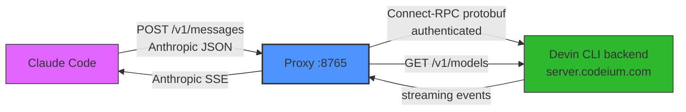

# cognition-claude-proxy-with-sm

> 本项目及 Devin Proxy Manager 是第三方代理工具，不是 Devin 或 Anthropic 官方客户端。

## macOS 菜单栏管理器

**Devin Proxy Manager** 是 macOS 14+ 的 SwiftUI 菜单栏应用。它通过当前用户的 LaunchAgent 托管本仓库的 Node.js 代理；退出菜单栏应用不会停止代理。菜单中分别显示代理运行状态、代理登录自启状态、管理器登录打开状态，提供启动、停止、重启、环境检查和日志查看。服务默认仅监听 `127.0.0.1:8765`，端口可在菜单中修改。

### 构建与安装

在本 Fork 仓库根目录执行：

```bash
./scripts/build-macos.sh
./scripts/install-macos.sh
open "$HOME/Applications/Devin Proxy Manager.app"
```

产物在 `dist/Devin Proxy Manager.app`。也可用 Xcode 打开 `macos/DevinProxyManager/Package.swift`，选择 `DevinProxyManager` scheme 构建；命令行等价构建为：

如需拖拽安装的磁盘映像，执行 `./scripts/build-dmg.sh`。产物为 `dist/Devin Proxy Manager-<版本>-macOS-<架构>.dmg`，内含应用、Applications 快捷方式和安装说明。DMG 不包含代理源码、Node.js 或 Devin CLI；首次打开应用后仍需选择本仓库目录。本地构建未经 Apple 公证。

```bash
xcodebuild -scheme DevinProxyManager -configuration Release -destination 'platform=macOS' build CODE_SIGNING_ALLOWED=NO
```

构建脚本使用本机临时签名制作 `.app`，仅供本地使用。安装脚本不会覆盖已有应用或现有代理；首次安装将本仓库路径写入管理器自己的偏好设置，不改 Claude Code、Devin CLI 或其他模型配置。

### 首次配置和服务控制

在菜单中确认项目目录、Node.js 绝对路径和端口，点击「保存设置」，再点「检查运行环境」和「启动」。Node.js 自动搜索 Apple Silicon Homebrew 的 `/opt/homebrew/bin/node`、Intel Homebrew 的 `/usr/local/bin/node` 等位置，要求 Node 18+。Devin CLI 凭据默认只检查 `~/.local/share/devin/credentials.toml` 的可读性；若 Devin 使用其他路径，在菜单输入凭据文件路径。凭据内容不会被环境检查读取或写入 plist。

「登录时自动启动代理」控制代理的 LaunchAgent；「登录时打开管理器」控制菜单栏应用登录项，二者独立。代理崩溃时 launchd 会尝试恢复；菜单中手动停止会从当前登录会话卸载服务，`dclaude` 不会把它重新拉起。若开启代理登录自启，**下次登录**会启动代理；关闭则下次登录保持停止。更改项目或 Node.js 路径后保存并重启代理，plist 会更新为新绝对路径。移动 `.app` 不影响已运行的代理；移动仓库后需在菜单重新选择目录并重启。

日志位于 `~/Library/Logs/DevinProxyManager/`，`runtime.log` 和 `error.log` 各限制在约 5 MiB，超过时从空文件重新记录。管理模式不会启用代理的请求体调试转储。菜单可查看日志末尾或打开 Finder 目录。

### 从手动代理迁移

若 `8765` 已由旧仓库或手动启动的 Node 进程占用，管理器会显示占用进程 PID 并拒绝启动，**不会自动终止或接管**。先让使用旧代理的工作完成，再在原终端正常停止那个明确的进程，确认端口空闲，然后在菜单启动。本 Fork 的 `bin/dclaude` 检测到管理器创建的 LaunchAgent 后，只复用健康的受管理进程；显式停止后会报错并提示从菜单启动。未安装管理器时，它保留原有的按需启动路径。旧仓库的 `dclaude` 符号链接不会被安装脚本替换；如需使用本 Fork 的包装脚本，请自行确认当前 `command -v dclaude` 和符号链接目标后再切换。

### 常见故障

- **端口冲突**：用 `lsof -nP -iTCP:8765 -sTCP:LISTEN` 查归属。不要按 `node` 进程名批量终止。
- **环境检查失败**：核对 Node.js 版本、项目目录、凭据文件路径和端口。凭据缺失时先运行 `devin auth login`。
- **健康检查失败**：查看菜单中的错误日志；检查 `launchctl print gui/$(id -u)/com.gitrocyang.devin-proxy-manager.proxy`。
- **`dclaude` 提示服务已停止**：在管理器中点「启动」。如果希望恢复原 CLI 自动启动方式，按下方步骤卸载管理器的 LaunchAgent。
- **登录项不生效**：代理自启依赖用户 LaunchAgent；管理器登录项使用 macOS ServiceManagement，系统可能要求在「登录项」中允许本地签名应用。

### 恢复 CLI 与完整卸载

先退出管理器，再执行：

```bash
./scripts/uninstall-macos.sh
```

脚本只卸载带本管理器标记的 LaunchAgent，先通过 `launchctl bootout` 停止其服务，再删除 plist 与安装在 `~/Applications` 的应用，并尝试注销应用登录项。它不会触碰旧仓库、其他 Node 进程或 Claude Code 配置。日志保留供排查，可自行删除 `~/Library/Logs/DevinProxyManager`。卸载后本 Fork 的 `bin/dclaude` 恢复原有按需启动行为；若要恢复旧版 CLI 命令，仍需自行把 `dclaude` 符号链接指回旧仓库。

### 自动化验证

```bash
npm run test:unit
cd macos/DevinProxyManager && swift test
CCP_MANAGER_INTEGRATION=1 swift test --filter testLaunchAgentLifecycleOnIsolatedPort
```

集成测试使用独立的 `18765` 端口和临时目录，不发送真实 Devin 推理请求；仅在明确设置环境变量后运行。运行前会检查固定测试端口和 LaunchAgent 标识是否空闲，结束后卸载测试服务。

A local proxy that lets **Claude Code** (or any Anthropic-API client) use
**Devin's model catalog** — SWE-2, GLM-5.2, DeepSeek V4.1 Flash, and 200+
others — as its backend. It translates the Anthropic Messages API to the
Connect-RPC format that the Devin CLI uses, and translates the streaming
responses back to Anthropic SSE.

## How it works



<details>
<summary>Plain-text flow</summary>

```
claude  (ANTHROPIC_BASE_URL=http://localhost:8765)
  -> POST /v1/messages            (Anthropic Messages API, JSON)
    -> proxy: translate to Connect-RPC protobuf
      -> POST https://server.codeium.com  (authenticated via local Devin CLI credentials)
    <- Connect server-stream of events (text/thinking/tool-call/usage)
  <- Anthropic SSE events (message_start/content_block_*/message_delta)
```

</details>

The proxy authenticates using your local Devin CLI credentials
(`%APPDATA%\devin\credentials.toml` on Windows;
`$XDG_DATA_HOME/devin/credentials.toml` or `~/.local/share/devin/credentials.toml`
on Linux/macOS). No API keys to manage — if `devin` works, `dclaude` works.

## Prerequisites

- [Node.js](https://nodejs.org/) 18+
- [Devin CLI](https://devin.ai/) installed and authenticated (`devin` command works)
- [Claude Code](https://docs.anthropic.com/en/docs/claude-code) installed (`claude` command works)

## Quick start

```powershell
git clone https://github.com/gitrocyang/cognition-claude-proxy-with-sm.git
cd cognition-claude-proxy-with-sm

# Option A: use the wrapper (auto-starts the proxy)
bin\dclaude.bat -p "hello"

# Option B: start the proxy manually
node src/server.js            # starts on 127.0.0.1:8765
# then in another shell:
set ANTHROPIC_BASE_URL=http://localhost:8765
set ANTHROPIC_AUTH_TOKEN=test
claude -p "hello"
```

On macOS/Linux, use `bin/dclaude` instead of the `.bat`:

```bash
chmod +x bin/dclaude
bin/dclaude -p "hello"

# optional: put it on PATH (symlink, not a copy — a stale copy shadows
# repo fixes and is the usual cause of wrapper bugs)
ln -s "$PWD/bin/dclaude" ~/.local/bin/dclaude
```

## Setup

```powershell
cd cognition-claude-proxy
node src/server.js            # starts on 127.0.0.1:8765
```

Then use the wrapper (put `bin\` on PATH or call directly):

```powershell
bin\dclaude.bat               # launches claude pointed at the proxy
bin\dclaude.bat --model swe-2 # pick any model from `devin models list`
bin\dclaude.bat --free        # all-SWE-2; identical to --swe2 since GLM left the free plan
```

On macOS/Linux, `bin/dclaude` takes the same flags.

Env knobs: `CCP_PORT` (default 8765), `CCP_API_KEY` (override credential),
`CCP_CREDENTIALS` (override credentials.toml path), `CCP_UPSTREAM`
(override backend URL), `CCP_DEFAULT_MODEL` (default `swe-2-high`),
`CCP_DEBUG` (log requests + dump bodies to `%TEMP%\ccp-*.json`),
`CCP_DEBUG_SSE` (dump emitted SSE to `%TEMP%\ccp-*.log`).

## Model waterfall

`dclaude.bat` maps Claude Code's tier aliases to a pinned model waterfall:

| Tier | Alias | Model | Effort | Context |
|------|-------|-------|--------|---------|
| Plan (planner subagent) | fable | `deepseek-v4-1-flash-max[1m]` | max | 1M |
| Orchestrate + deep-plan (main thread) | opus | `glm-5-2` | high | 200K |
| Execute + verify (separate subagents) | sonnet | `swe-2-max` | max | 262K |
| Background | haiku | `swe-2-max` | max | 262K |

`--free` / `--swe2` (identical since GLM left the free plan 2026-09-18):
all-SWE-2 — every tier `swe-2-max`; planner drops to 262K (no 1M SWE-2
variant exists).

## Models & context windows

`GET /v1/models` live-syncs from the upstream model catalog — the same call
`devin models list` uses — returning every available model with its
`context_window` and `max_output_tokens`. If the fetch fails it falls back to
a bundled snapshot (`src/models.json`, 398 entries).

Claude Code decides context accounting client-side. The proxy configures
per-model context windows via a `claude-settings.json` file (passed through
`--settings`) containing `modelPicker` rows with `[1m]` suffixes for 1M-context
models and `behavesAs` entries for 200K models. Run
`node scripts/gen-settings.js` to regenerate it from `src/models.json`.

## Status

Verified end-to-end with real `claude -p` sessions: text + thinking deltas,
tool calls (streamed JSON args), tool results, usage stats, multi-turn agent
loops (SWE-2 called the `Write` tool through Claude Code and it executed).
MCP tools (Playwright, context7, etc.) work through the proxy.

Not yet handled: images (replaced with a text placeholder), prompt caching
(`cache_control` is stripped), `thinking.budget_tokens` mapping.

## Compatibility notes

- The upstream backend runs a pre-inference content filter. Claude Code's
  system prompt contains phrases that trip it, so the proxy replaces the
  system prompt with a neutral equivalent (`sanitizeSystem` in
  `src/translate.js`). Tool descriptions are also sanitized and capped at
  480 chars. If a request fails with `permission_denied: "content policy"`,
  check the proxy console log and extend the sanitizer.
- Cloud MCP connectors (Drive, Gmail, Calendar) are disabled by Claude Code
  when a custom `ANTHROPIC_AUTH_TOKEN` is set. Local/stdio MCPs work fine.
- `[1m]` is the only context suffix Claude Code recognizes — `[262k]` is not
  parsed and would be sent upstream as part of the model name.

## Troubleshooting

**`permission_denied: "content policy"`** — The upstream content filter
rejected something in the request. Check the proxy console log for the
upstream error. If Claude Code updated its system prompt with new phrases,
extend `sanitizeSystem` in `src/translate.js`.

**`permission_denied: "MCP configuration issue"`** — Misleading; this is
usually a tool description tripping the content filter, not an actual MCP
problem. Check which tool description triggered it and extend
`sanitizeToolDesc` in `src/translate.js`.

**Empty response from Claude Code** — The proxy is running but Claude Code
shows nothing. Ensure the proxy started successfully (check
`http://localhost:8765/health` returns `{"ok":true}`). If it did, run with
`CCP_DEBUG=1` to dump request/response bodies to `%TEMP%\ccp-*.json`.

**`windsurf_api_key not found` / `credentials file not readable`** — The
proxy couldn't find your Devin CLI credentials. Ensure `devin auth login`
has been run; the file is `%APPDATA%\devin\credentials.toml` on Windows and
`$XDG_DATA_HOME/devin/credentials.toml` (else
`~/.local/share/devin/credentials.toml`) on macOS/Linux. Or set
`CCP_API_KEY` directly.

**Model not found / wrong context window** — Run `node scripts/gen-settings.js`
to regenerate `claude-settings.json` from the latest `src/models.json` snapshot.
To refresh the snapshot, fetch a live `GetCliModelConfigs` response and
decode it (see `src/models.js` for the field mapping).

**Proxy port already in use** — Set `CCP_PORT=8766` (or any free port) before
starting the proxy. If using `dclaude.bat`, set it in the environment before
running the wrapper.

**Upstream API changed** — If the backend protocol changes, the proxy will
break. The field mappings are in `src/codeium.js` (request encoding) and
`src/translate.js` (response decoding). Check the proxy console log for
decode errors. PRs welcome.

## Verify your setup

```powershell
node scripts/test.js    # checks /health and /v1/models
npm run test:unit       # credential-path unit tests (no proxy needed)
```
